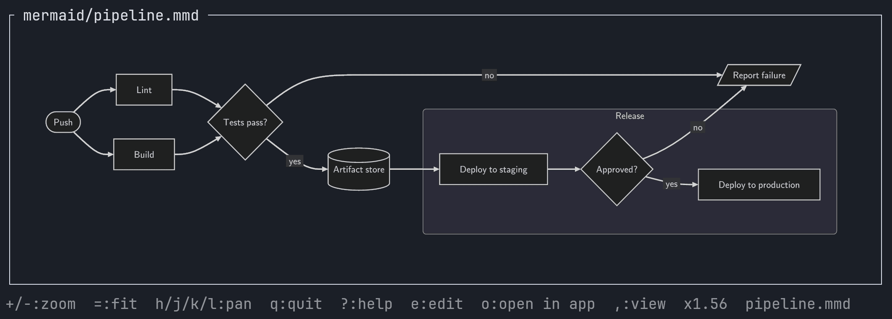
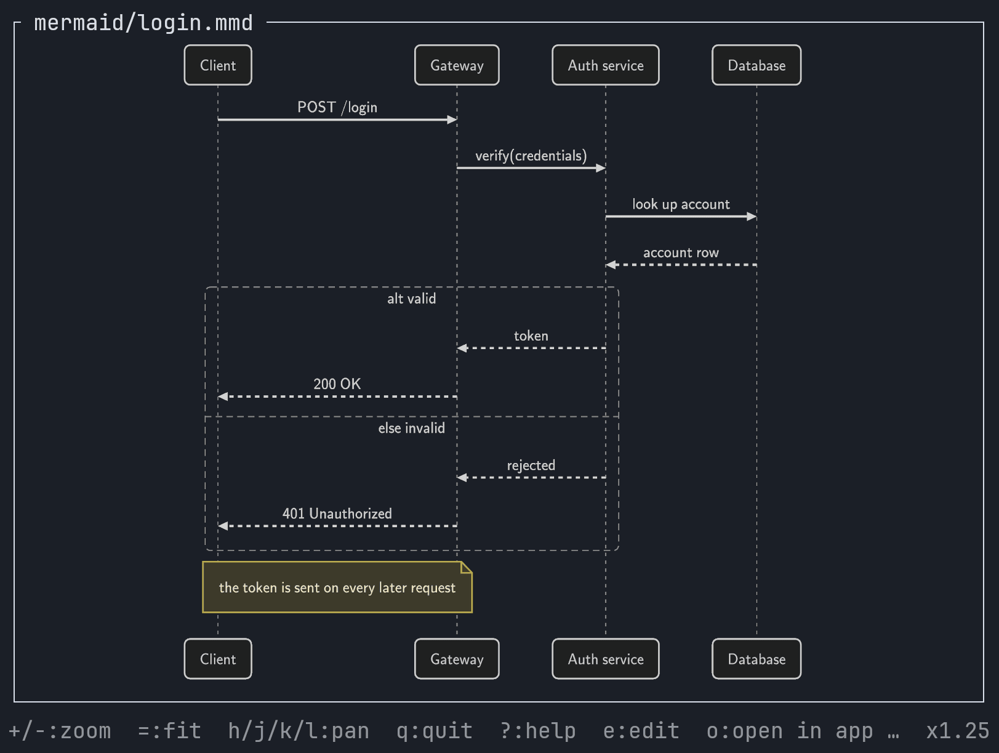

# konoma-mermaid

Mermaid diagrams drawn without a browser or Node: the renderer of
[konoma](https://github.com/LESIM-Co-Ltd/konoma), a terminal file browser, and its plugin.





| Crate | What it is |
| --- | --- |
| [`konoma-mermaid-core`](crates/konoma-mermaid-core/README.md) | Library: Mermaid source to SVG, with its own parsers and layout. |
| [`konoma-mermaid`](crates/konoma-mermaid/README.md) | konoma's `mermaid` plugin, and a program that shows one diagram file. |

## Try it

From a clone of this repository:

```sh
printf 'flowchart LR\n  A[Source] --> B[SVG]\n' > flow.mmd
cargo run -p konoma-mermaid -- flow.mmd
```

Press `q` to quit. If you have konoma, it can show the gallery of diagram kinds in `samples/`
(the standalone program does not open Markdown):

```sh
konoma samples/mermaid.md
```

## Build and test

Rust 1.92 or later.

```sh
cargo build
cargo test
```

CI runs on macOS and Ubuntu, with and without default features, and also checks formatting and
clippy. Some tests measure labels against installed fonts. On Ubuntu CI installs `pkg-config`,
`cmake`, `libssl-dev`, `zlib1g-dev`, `fontconfig-config`, `fonts-dejavu-core`,
`fonts-freefont-ttf`, `fonts-droid-fallback` and `fonts-noto-color-emoji`.

## License

The code written for this repository is MIT (see [LICENSE](LICENSE)). `konoma-mermaid-core` also
contains third-party code, so its license expression is `MIT AND Apache-2.0 AND ISC`:

- `crates/konoma-mermaid-core/src/layout/` is a modified copy of the `dagre` crate by kookyleo and
  stays under Apache-2.0. See its [license](crates/konoma-mermaid-core/src/layout/LICENSE-APACHE)
  and [provenance](crates/konoma-mermaid-core/src/layout/PROVENANCE.md).
- Parts are ported from dagre.js, graphlib, dagre-d3-es and mermaid (MIT) and d3-shape (ISC). See
  the [third-party notices](crates/konoma-mermaid-core/THIRD-PARTY-NOTICES.md).

The released binaries also embed the KaTeX fonts (SIL Open Font License 1.1) and statically link
other Rust crates. Their notices are in [THIRD-PARTY-LICENSES.md](THIRD-PARTY-LICENSES.md), which
ships in each release archive. It is regenerated by hand with `scripts/third-party-licenses.sh`
(needs `cargo install cargo-about --features cli` and `python3`), after changing dependencies or the
notices and before tagging a release. The release build resolves dependencies again, so its versions
can differ from the list; the comments in the script say how.
