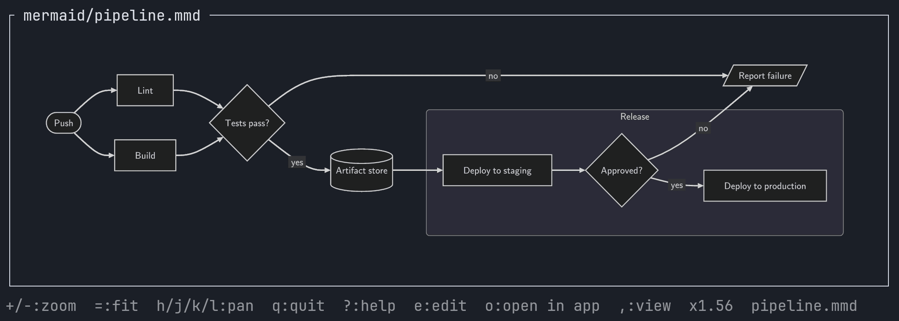
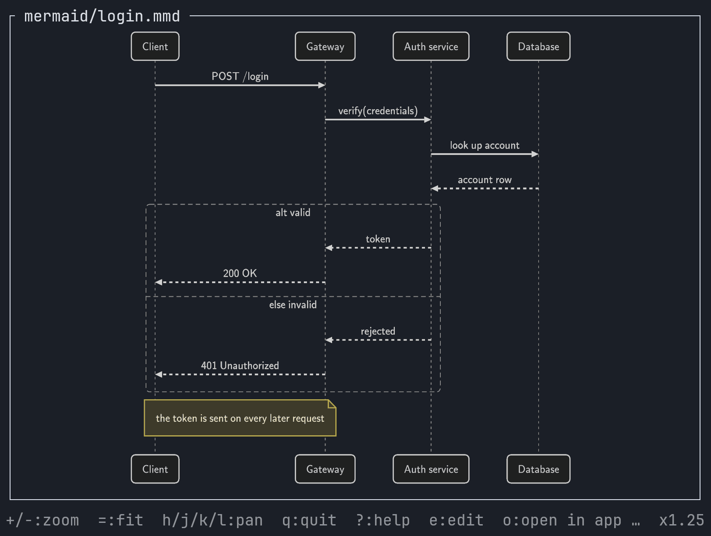

# konoma-mermaid-core

Mermaid source to an SVG string, in Rust: its own parsers, a copy of the `dagre` layout engine and
its own SVG writer. No browser, no Node. It is the renderer of
[konoma](https://github.com/LESIM-Co-Ltd/konoma).

It does not aim to match mermaid.js pixel for pixel. It paints no background, does not rasterize,
and does not draw to a terminal.





## Usage

```toml
[dependencies]
konoma-mermaid-core = "0.1"
```

```rust
fn main() {
    let source = "flowchart LR\n  A[Source] --> B[SVG]";
    match konoma_mermaid_core::mermaid_to_svg_reason(source, "dark") {
        Ok(svg) => println!("{svg}"),
        Err(why) => eprintln!("not drawn: {why}"),
    }
    let flow = konoma_mermaid_core::mermaid_to_svg_flow(source, "light", "linear", "splines");
    assert!(flow.is_some());
}
```

## Entry points

These work for every supported diagram kind and catch panics from the renderer:

| Function | Returns |
| --- | --- |
| `mermaid_to_svg(code, theme)` | `Option<String>` |
| `mermaid_to_svg_curve(code, theme, curve)` | `Option<String>` |
| `mermaid_to_svg_flow(code, theme, curve, routing)` | `Option<String>` |
| `mermaid_to_svg_reason(code, theme)` | `Result<String, String>`, with the reason |
| `mermaid_to_svg_reason_curve`, `mermaid_to_svg_reason_flow` | the same, with the extra arguments |
| `warm_mermaid()` | draws a few small diagrams (`graph`, `sequenceDiagram`, `pie`, `gantt`), to pay start-up costs early |

The parsers and the lower-level `render` module are public too (`render::render*` is the
flowchart path only).

- `theme`: `dark`, `light`, `classic`, `forest`, `neutral`. Unknown values mean `dark`.
- `curve` (flowcharts only): `basis`, `linear`, `step`, `stepBefore`, `stepAfter`, `natural`,
  `cardinal`, `catmullRom`, `monotoneX`, `monotoneY`, `bumpX`, `bumpY`, `rounded`. Unknown values
  mean `basis`.
- `routing`: `splines`, or `konoma-orthogonal` for right-angle edges in flowcharts and state
  diagrams. That mode has its own palette and lines, so `theme` and `curve` have no effect on those
  two kinds.

## Diagram kinds

`flowchart` / `graph` / `flowchart-elk`, `stateDiagram`, `classDiagram`, `erDiagram`,
`sequenceDiagram`, `zenuml`, `mindmap`, `kanban`, `journey`, `timeline`, `gantt`,
`requirementDiagram`, `gitGraph`, C4, `block-beta`, `architecture-beta`, `pie`, `xychart-beta`,
`quadrantChart`, `radar-beta`, `treemap-beta`, `packet-beta`, `sankey-beta`.

Anything else is an error that names the first word of the source.

## Limits on large input

| Input | Limit | Beyond it |
| --- | --- | --- |
| flowchart edges | 500 | extra edges are left out, without an error |
| state transitions | 500 | left out |
| class relations | 500 | left out |
| ER relationships | 500 | left out |
| state / class / ER block nesting | 32 | deeper blocks are not opened |
| sequence messages | 500 | error |
| packet diagram | 128 rows of 32 bits, 10,000 fields | error |
| radar ticks | 32 | clamped |

There is no limit on source size, node count or running time, and these limits do not cover every
diagram kind. Bound untrusted input yourself, and call the renderer off your UI thread.

## Fonts, features, platforms

Labels are measured against the system's fonts (through
[`konoma-svg`](https://crates.io/crates/konoma-svg)), so geometry can differ between machines.
Rasterize with the same fonts for labels to fit. No feature flags. Rust 1.92 or later. CI runs on
macOS and Ubuntu.

## License

[MIT](https://github.com/LESIM-Co-Ltd/konoma-mermaid/blob/main/LICENSE), except `src/layout/`: a
modified copy of the `dagre` crate 0.1.1, copyright kookyleo, under
[Apache-2.0](https://github.com/LESIM-Co-Ltd/konoma-mermaid/blob/main/crates/konoma-mermaid-core/src/layout/LICENSE-APACHE)
([changes](https://github.com/LESIM-Co-Ltd/konoma-mermaid/blob/main/crates/konoma-mermaid-core/src/layout/PROVENANCE.md)).
