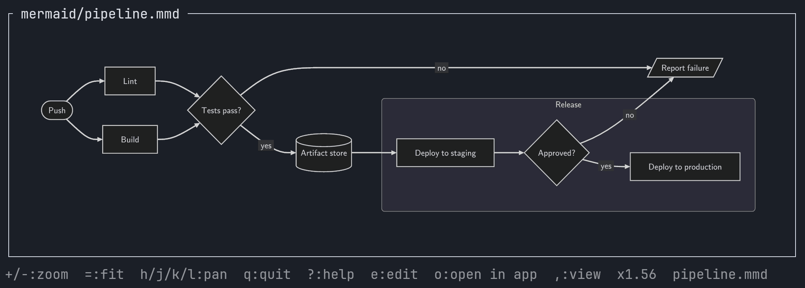
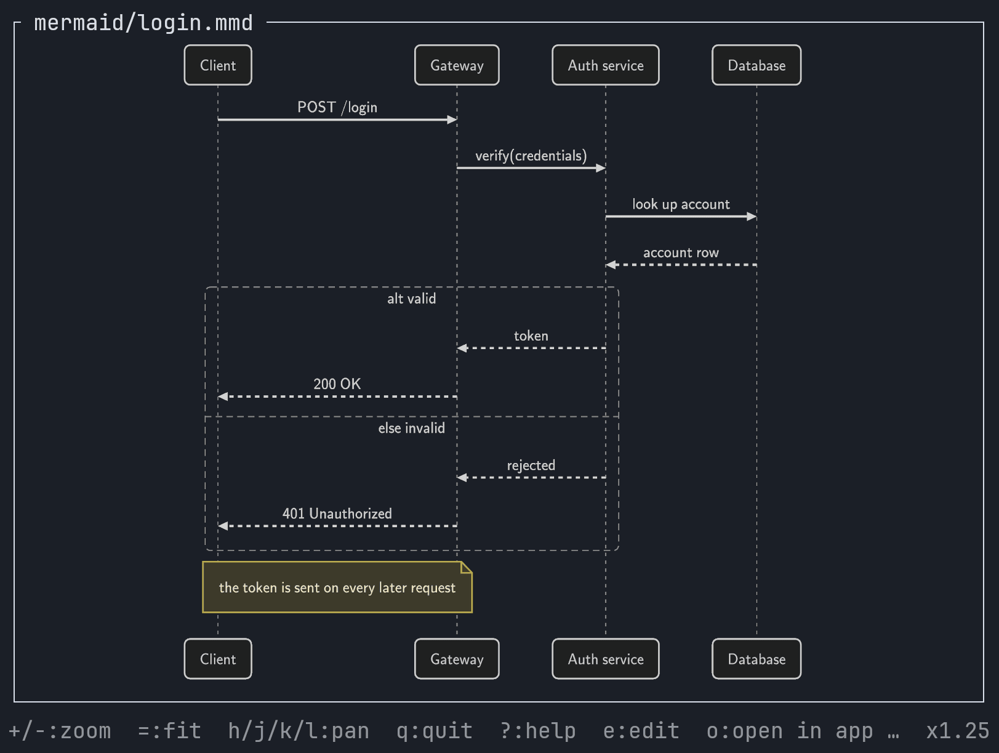

# konoma-mermaid

The `mermaid` plugin of [konoma](https://github.com/LESIM-Co-Ltd/konoma), a terminal file browser,
and a program that shows one diagram file full screen. Diagrams are drawn by
[`konoma-mermaid-core`](https://crates.io/crates/konoma-mermaid-core), with no browser or Node.





## In konoma

The plugin is built in: `.mmd` and `.mermaid` files and ```` ```mermaid ```` fences in Markdown are
drawn without installing anything. `konoma plugin install konoma-mermaid` is refused for that
reason. `konoma plugin update konoma-mermaid` is the command for taking a newer compatible version
of a built-in plugin, and rebuilds konoma.

Settings go in konoma's `config.toml`; see
[CONFIGURATION.md](https://github.com/LESIM-Co-Ltd/konoma/blob/main/CONFIGURATION.md) for details.

```toml
[plugins.mermaid]
mode = "image"       # or "text"
theme = "dark"       # light, classic, forest, neutral
curve = "basis"      # flowchart edges
routing = "splines"  # or "konoma-orthogonal" (see below)
rows = 24            # height cap of a diagram inside Markdown
```

With `routing = "konoma-orthogonal"`, flowcharts and state diagrams use that mode's own colors and
lines, so `theme` and `curve` do not apply to them.

With `mode = "text"`, konoma 0.32.0 draws a `.mmd` file with box-drawing characters, and shows a
fence inside Markdown as its source. Text drawing covers fewer diagram kinds than pictures do: a
kind it cannot draw (kanban or C4, for example) is shown as its source under a note.

## The standalone program

```sh
cargo install konoma-mermaid     # Rust 1.92 or later
konoma-mermaid <file.mmd>
```

It takes one `.mmd` or `.mermaid` file. Markdown files are not accepted.

| Argument | Effect |
| --- | --- |
| `<file>` | Show the diagram. Standard input and output must be a terminal. |
| `--help`, `-h` | Print the usage text. |
| `--version` | Print `mermaid <version>`. |
| `--manifest` | Print what the plugin declares, as JSON. |
| `--serve` | Serve a konoma plugin host on standard input and output. |
| `--plugin mermaid` | Names the plugin; optional, since the program carries only one. |

konoma does not load this program in place of its built-in plugin, because the id `mermaid` is
already taken.

### Keys

| Key | Action |
| --- | --- |
| `+` / `-` | Zoom |
| `=` | Fit |
| `h` `j` `k` `l`, arrows | Pan when the picture is larger than the view |
| `e` | Open the file in your external editor |
| `o` | Open the file with the OS default application |
| `y` then `n`, `r`, `f`, `p` or `@` | Copy to the clipboard: the file name, relative path (as in the title), full path, parent directory, or an `@path` reference relative to the directory the program was started in |
| `Space` | Menu |
| `,` | Sort and display menu (`p` switches how the path in the title is shown) |
| `?` | Help |
| `q`, `Esc`, `Q` | Quit |

### Terminal

Real pixels need a terminal with kitty graphics, iTerm2 images or sixel. Without one the diagram is
approximated with half-block characters, and small labels are not readable.

### Configuration

The program reads konoma's config file (`$XDG_CONFIG_HOME/konoma/config.toml`, else
`~/.config/konoma/config.toml`) for shared settings such as keys and the editor. In version 0.1.0
**it does not apply the `[plugins.mermaid]` table**: it always draws a picture with the `dark`
theme, `basis` curves and spline routing.

### Limits

- Files must be UTF-8 and at most 1 MiB.
- A file that cannot be drawn (an unsupported diagram kind, a file over the limit) is shown as its
  source text instead.
- The [renderer's limits](https://crates.io/crates/konoma-mermaid-core) apply; some of them leave
  out the extra items without saying so.
- No export to an image file.

## As a library

`MermaidPlugin` and `mermaid_manifest()` implement the
[`konoma-plugin`](https://crates.io/crates/konoma-plugin) interface; `text_diagram(code, width)`
gives the text rendering (through [`mermaid-text`](https://crates.io/crates/mermaid-text)), or the
source under a note for what it cannot draw. The default feature `app` builds the program; depend
with `default-features = false` to leave it out.

License: [MIT](https://github.com/LESIM-Co-Ltd/konoma-mermaid/blob/main/LICENSE); the renderer
includes an [Apache-2.0 part](https://crates.io/crates/konoma-mermaid-core).
